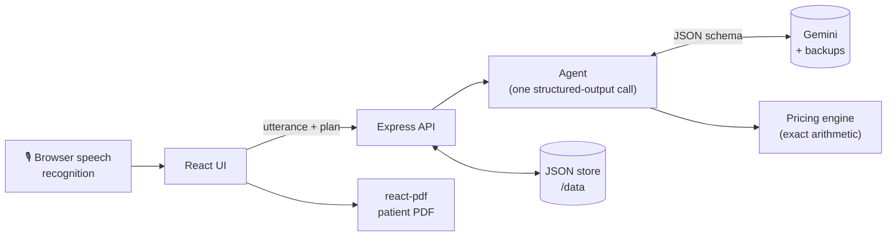

<div align="center">

# 🦷 DentPlan AI

**Dictate a dental treatment plan. Get staged visits, exact prices and a patient-ready PDF.**

[](https://hub.docker.com/r/kacemab/dentplan)
[](https://hub.docker.com/r/kacemab/dentplan)


[](LICENSE)

[Quick start](#-quick-start-docker) · [Features](#-features) · [How it works](#-how-it-works) · [Security](#-security--privacy) · [Architecture](docs/ARCHITECTURE.md)

</div>

---

DentPlan is a voice-first assistant for dental clinics. The dentist speaks the plan naturally, for example *"Root canal on 36, then a zirconia crown two weeks later. Extract 46 and place an implant after three months."* An AI agent turns it into a structured treatment plan with **stages**, **intervals between visits** and **prices**. It asks follow-up questions about anything ambiguous, and when the dentist is satisfied it produces a polished **PDF** for the patient.

## ✨ Features

| | |
|---|---|
| 🎙 **Voice first** | Dictate in English, Ukrainian, Polish, French, Arabic and more. The patient PDF stays in English. |
| 🤖 **An assistant that asks** | Unclear items (crown material, missing prices…) become one-click questions instead of guesses. |
| 🦷 **Tooth chart & timeline** | Every tooth is coloured by the stage that treats it, with symbols for extraction, implant, crown and root canal. Click a tooth to filter the plan. |
| ✦ **You stay in control** | Everything the AI changed is highlighted, and **Undo** reverts its last update. |
| 💶 **Exact prices** | Clinic price list, dictated prices, per-item and whole-plan discounts. **All arithmetic is done in code, never by the AI.** |
| 📄 **Patient-ready PDF** | "Your treatment at a glance" overview, stage-by-stage costs, savings, validity and signature lines. |
| 📊 **Practice dashboard** | Track each case from Draft → Ready → Presented → Accepted / Declined, with acceptance rate and accepted value. |
| 🛟 **Resilient AI** | Backup Gemini models take over when the main one is slow or overloaded, with optional Groq as a last resort. |

## 🚀 Quick start (Docker)

You need [Docker](https://docs.docker.com/get-docker/) and a free [Gemini API key](https://aistudio.google.com/apikey).

```bash
# 1. Put your secrets in a local .env file (never commit it)
cp .env.example .env        # then paste your key after GEMINI_API_KEY=

# 2. Run the published image
docker run -d --name dentplan \
  --env-file .env \
  -p 127.0.0.1:3001:3001 \
  -v dentplan-data:/data \
  kacemab/dentplan:latest
```

Open **http://localhost:3001** in **Chrome or Edge** (needed for voice dictation) and allow the microphone.

Or, with Docker Compose from a clone of this repository:

```bash
cp .env.example .env   # add your key
docker compose up -d   # builds or pulls kacemab/dentplan, publishes on 127.0.0.1:3001
```

> **No API key yet?** On the empty Plans page, click **Explore with demo patients** to load six sample cases, a sample price list and clinic details. Browsing them needs no key.

### Configuration

Everything is set through environment variables, passed **at run time** (none are baked into the image):

| Variable | Required | Description |
|---|---|---|
| `GEMINI_API_KEY` | ✅ | Google Gemini API key |
| `GEMINI_MODEL` | | Main model (default `gemini-3.8-flash`) |
| `GEMINI_FALLBACK_MODELS` | | Comma-separated backup models |
| `GEMINI_HEDGE_DELAY_MS` | | Start the next model if one has not answered after this many ms (default `20000`) |
| `GEMINI_TURN_BUDGET_MS` | | Time limit for one assistant turn (default `120000`) |
| `GROQ_API_KEY` / `GROQ_MODELS` | | Optional last-resort backup provider |
| `DENTPLAN_PASSWORD` | ⚠️ | Password for the whole app (HTTP basic auth, any user name). **Required if the app is reachable from outside your computer.** |
| `PORT` | | Server port (default `3001`) |
| `HOST` | | Bind address (default `127.0.0.1`; the image uses `0.0.0.0` inside the container) |
| `DENTPLAN_DATA_DIR` | | Where plans, prices and settings are stored (image: `/data`) |

### Data & backups

Plans, the price list and settings are JSON files in the `/data` volume (`./data` when run without Docker). To back them up:

```bash
docker run --rm -v dentplan-data:/data -v "$PWD":/backup alpine tar czf /backup/dentplan-backup.tgz -C /data .
```

## 🧑‍⚕️ Daily use

1. **Plans → + New plan**, then type the patient's name.
2. Click **Dictate** and speak the plan naturally.
3. Check the transcript and press **Send** (or <kbd>Ctrl</kbd>+<kbd>Enter</kbd>).
4. The assistant builds the stages and asks questions (*"Crown on 36: zirconia or PFM?"*). Click an answer or dictate it, then **Send**. Repeat until no questions are left.
5. AI changes are highlighted (**new** / **updated**). Click **Looks good** to accept them, or **Undo** to take them back. Your dictation returns to the box so you can correct it.
6. Edit anything in the plan table yourself: prices, teeth, intervals, stage order and discounts. Your edits are kept.
7. Click **I'm satisfied → PDF**, check the preview, and choose **Download PDF**.
8. Move the case through **Presented → Accepted / Declined**. **Duplicate** copies a plan to offer an alternative.

### How prices work

| Badge | Meaning |
|---|---|
| *price list* | Taken from your price list (always the current list price) |
| *dictated* | You said the price. It overrides the list. |
| *edited* | You typed it in the table |
| *missing* | Unknown. The assistant asks for it, and it shows as **TBC** on the PDF (not counted in the total). |

Item discounts (*"healing abutments −30%"*) go in that row's **Disc.** column. Whole-estimate discounts (*"military serviceman −30%"*) go in the plan discount. If the two could be the same discount, the assistant applies it once and asks.

## 🧠 How it works



- **One schema, everywhere.** zod schemas in `shared/` validate client data, server requests *and* the model's structured output.
- **The model never does maths.** It proposes procedures and prices. `shared/pricing.ts` reconciles them with the price list and computes every total.
- **Every AI turn is reversible.** The previous version is snapshotted and a diff drives the highlights.
- **Hedged requests.** If the main model is slow, a backup starts in parallel and the first valid answer wins (`server/hedge.ts`).

Full design notes: [docs/ARCHITECTURE.md](docs/ARCHITECTURE.md).

## 🔐 Security & privacy

- **API keys stay on the server.** They are read from environment variables, are never sent to the browser, and are **not stored in this repository or in the Docker image**. `.env` is git- and docker-ignored.
- **Private by default.** The server binds to `127.0.0.1`, and the Docker examples publish the port on `127.0.0.1` only, so the API is not reachable from your network.
- **Before exposing it** (LAN, reverse proxy, ngrok…), set `DENTPLAN_PASSWORD`. Without it, anyone with the address could read your plans and spend your AI quota.
- The container runs as an unprivileged `node` user.
- Dictation text and the current plan are sent to the Google Gemini API (and to Groq only if configured and every Gemini model fails). Chrome and Edge send microphone audio to their own speech service. We recommend typing patient names rather than dictating other personal identifiers.

## 🛠 Development

Requires **Node.js 22+**.

```bash
npm install
cp .env.example .env     # add your GEMINI_API_KEY
npm run dev              # API on :3001 + Vite on http://localhost:5173 with hot reload
```

Production build without Docker:

```bash
npm run build && npm start   # http://localhost:3001
```

| Command | Purpose |
|---|---|
| `npm test` | Unit tests (Vitest) |
| `npm run typecheck` | TypeScript checks |
| `npm run try-agent` | One real AI call with a sample dictation (needs a key) |
| `npm run test-patients -- <all\|1,4> <notes.txt>` | Runs each `PATIENT n` block of a notes file through the assistant; results in `test-output/` |
| `npm run sample-pdf` | Writes `sample-plan.pdf` to check the PDF layout |
| `npm run import-prices -- <file.xlsx>` | Replaces the price list from Excel (columns: Service, Code, Price) |
| `docker build -t dentplan .` | Builds the image locally |

### Project layout

```
server/   Express API, AI agent, prompt, hedging, JSON store, demo data
shared/   zod schemas, pricing engine, formatting, tooth-chart logic (client + server)
src/      React UI, speech-recognition hook, tooth chart, PDF document
scripts/  Dev utilities (agent smoke test, price import, sample PDF)
docs/     Architecture notes
```

### Tech stack

React 19 · Vite · TypeScript · Express 5 · zod · @react-pdf/renderer · Google Gen AI SDK · Groq SDK · Vitest · Docker

## 📄 License

[MIT](LICENSE) © 2026 Kacem Abdelbaki
