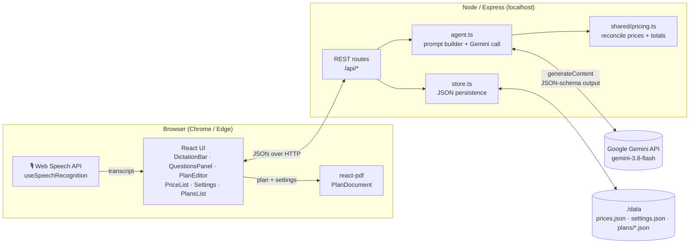
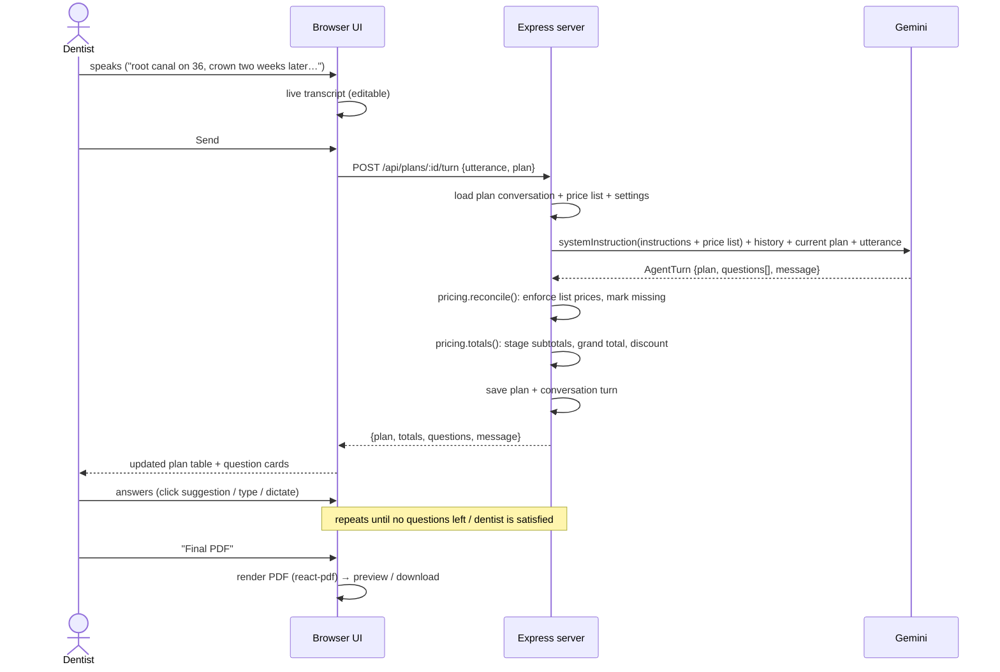

# DentPlan: Architecture

A local web app for one dental clinic. The dentist **dictates a treatment plan by voice**. An AI agent (Google Gemini) turns it into a structured plan with **stages, intervals between visits, procedures, and prices**, and **asks follow-up questions** about anything ambiguous until the dentist is satisfied. The app then produces a patient-ready **PDF**.

---

## 1. Key decisions

| Topic | Decision | Why |
|---|---|---|
| Deployment | One clinic, one PC: a local web app at `http://localhost:5173` (dev) or `http://localhost:3001` (prod) | No accounts or hosting needed; data stays on the clinic PC |
| Language | Dictation in any supported language (setting); the assistant answers in it; the PDF stays in English | Clinics dictate in their own language; patient documents use one template |
| Voice | Browser Web Speech API (`webkitSpeechRecognition`), Chrome/Edge | Free, no extra API key, live transcript |
| Agent | Google Gemini (`gemini-3.8-flash` by default, set with `GEMINI_MODEL`; backup models take over when it is overloaded or slow), **one structured-output call per turn** | The task is "update the plan and ask questions", so no tool loop is needed |
| Prices | **Clinic price list** fills prices automatically; a **dictated price overrides** it; anything else is marked `missing` and asked about | Consistent quotes plus flexibility |
| Arithmetic | **Done in code, never by the model** | Totals must be exact |
| Discounts | Per item (`procedure.discountPercent`) and per plan (`plan.discountPercent`), applied in that order | Real cases mix both ("abutments −30%", "serviceman −30%") |
| Trust | Each assistant turn saves the previous version (undo) and a diff of what it changed (highlights) | The dentist must be able to see and reverse AI edits |
| Backup AI | Gemini models first; Groq (`gpt-oss-120b`) last, only if `GROQ_API_KEY` is set | A failed turn during a consultation is worse than a slower one |
| PDF | `@react-pdf/renderer` in the browser | Live preview, no server-side rendering stack |
| Storage | JSON files in `./data/` | Single machine; trivial to back up |
| Stack | TypeScript everywhere: React + Vite (client), Express (server), zod (shared schemas) | One language, schema shared between client, server, and the Gemini output format |

---

## 2. Component view



* The **API key never reaches the browser**. Only the server reads `GEMINI_API_KEY` from `.env`.
* Speech recognition runs in the browser. In Chrome, audio is processed by Google's speech service (see §9).

---

## 3. One dictation turn



Manual edits in the plan table (a price, a tooth, deleting a procedure) are saved straight away. The **current plan** is sent with every turn, so the agent always works from what the dentist sees.

---

## 4. Data model (`shared/schema.ts`)

```ts
Interval     { value: number; unit: "days" | "weeks" | "months" }

Procedure    { id: string
               name: string               // "Root canal treatment (molar)"
               teeth: string[]            // FDI: ["36"]  (or Universal)
               quantity: number
               priceSource: "list" | "dictated" | "missing" | "manual"
               priceListId: string | null // link to PriceItem when source = list
               unitPrice: number | null   // always the full price
               discountPercent: number    // item discount, 0–100
               notes: string }

Stage        { id: string
               title: string              // "Stage 2 – Endodontics"
               goal: string
               intervalBeforeStage: Interval | null   // null = first / immediately
               visits: number | null
               procedures: Procedure[] }

Plan         { patient: { name: string; notes: string }
               stages: Stage[]
               discountPercent: number
               generalNotes: string
               assumptions: string[] }

Question     { id: string; question: string; reason: string; suggestedAnswers: string[] }

AgentTurn    { plan: Plan; questions: Question[]; message: string }   // Gemini output format

PriceItem    { id: string; name: string; aliases: string[]; price: number | null; category: string }   // null = not set yet

Settings     { clinicName, clinicAddress, clinicPhone, dentistName, logoDataUrl,
               currency: string, toothNumbering: "FDI" | "Universal",
               validityDays: number, disclaimer: string,
               dictationLanguage: string }            // BCP-47, e.g. "uk-UA"

SavedPlan    { id, createdAt, updatedAt,
               status: "draft" | "final" | "presented" | "accepted" | "declined",
               plan: Plan, questions: Question[],
               conversation: { role: "dentist" | "agent"; text: string; at: string }[],
               versions: { at, utterance, plan, questions, conversationLength }[]  // undo stack, max 20
               lastChanges: { addedProcedureIds, changedProcedureIds, addedStageIds,
                              changedStageIds, removed: string[] } | null }

Totals       { stages: { stageId, subtotal, missingCount }[],
               gross, itemDiscount,        // full price, and savings from item discounts
               subtotal, discount, total, missingCount }
```

`priceSource: "manual"` marks a price the dentist typed into the table. The agent is told to keep it.

Plans saved by older versions are upgraded when read (`migrateSavedPlan`: item discounts 0, empty undo stack).

---

## 5. HTTP API

| Method | Path | Purpose |
|---|---|---|
| `GET` | `/api/health` | Server up + whether an API key is configured |
| `POST` | `/api/plans/:id/turn` | Agent turn: `{utterance, plan}` → saved plan + `{totals, questions, message}` |
| `GET` | `/api/plans` | List saved plans (id, patient, updatedAt, status, total) |
| `POST` | `/api/plans` | Create an empty plan → `SavedPlan` |
| `GET` | `/api/plans/:id` | Load one plan (with conversation) |
| `PUT` | `/api/plans/:id` | Save manual edits, status, or `lastChanges: null` (dismiss highlights) → returns recomputed totals |
| `POST` | `/api/plans/:id/undo` | Restore the version saved before the last assistant turn; returns `undoneUtterance` |
| `POST` | `/api/plans/:id/duplicate` | Copy a plan (new draft) |
| `DELETE` | `/api/plans/:id` | Delete a plan |
| `POST` | `/api/demo` | Load the demo clinic (six cases; sample prices and clinic details only if still empty) |
| `GET` / `PUT` | `/api/prices` | Read / replace the clinic price list |
| `GET` / `PUT` | `/api/settings` | Read / replace clinic settings |

---

## 6. Agent design (`server/agent.ts`)

**Call:** `ai.models.generateContent({ model: GEMINI_MODEL, contents, config: { systemInstruction, responseMimeType: "application/json", responseJsonSchema: z.toJSONSchema(AgentTurnSchema), maxOutputTokens: 16000 } })` using the official `@google/genai` SDK. The JSON schema is generated from the same zod schema the app validates with. A unit test checks that it uses only keywords Gemini supports. The reply is then parsed and validated with `AgentTurnSchema.safeParse`.

**System instruction** (stable across turns, so Gemini's implicit context caching can reuse it):
1. Role: dental treatment-planning assistant. Converts dictation into a phased plan.
2. Planning conventions:
   - a usual phase order (urgent/pain relief → hygiene/perio → endo → restorative → surgery/implants → prosthetics → maintenance)
   - realistic intervals, e.g. an implant needs about 3 months of osseointegration before the crown
   - this order is only a default; follow the dentist's dictation when it differs
3. Tooth numbering system from settings.
4. **Price rules:**
   - a price spoken by the dentist → `dictated`
   - else a matching price-list item → `list` with its `priceListId`
   - else `missing` plus a question
   - never invent a price; keep `manual` prices untouched
5. **Question rules:**
   - ask only what changes the plan or the price (tooth, surface, material, count, missing price, unclear order or interval)
   - at most 5 questions, most important first
   - give 2–4 suggested answers when they are obvious
   - return no questions once nothing material is left
   - never re-ask something already answered
6. Always return the **whole** updated plan; keep existing ids stable.
7. The clinic price list (id, name, aliases, price).

**Contents:** the conversation so far, with dentist turns as `user` and earlier agent replies as `model`. A reply is stored as its short message plus the questions asked, not the full JSON. The final `user` message contains the **current plan JSON** (which may include manual edits), the still-open questions, and the new utterance. The app holds the plan state, not the model's memory.

**Guardrails in code (`shared/pricing.ts`, also used by the browser for live totals):**
* `reconcilePrices(plan, priceList)`:
  - `list` items get the list price by `priceListId`
  - an unknown id becomes `missing`
  - `dictated` and `manual` prices are kept
  - a `null` price is forced to `missing`
  - quantities are clamped to ≥ 1, and ids are filled in when absent
* `computeTotals(plan)`: per-stage subtotals, discount, and the grand total, rounded to 2 decimals. Missing prices are counted, not guessed.

**Turn bookkeeping (`server/index.ts`):** before saving an assistant turn, the server pushes the previous plan, questions and conversation length onto `versions` (undo), and stores `diffPlans(before, after)` (`shared/pricing.ts`) in `lastChanges` so the editor can highlight new and updated rows.

**Backup models (`server/hedge.ts`):** Gemini models are sometimes overloaded (HTTP 503) or very slow. One turn therefore runs as a race over `MODELS` = `GEMINI_MODEL` followed by `GEMINI_FALLBACK_MODELS` (default `gemini-4-hydrogen`, `gemini-3.5-flash-lite`):
* the primary model starts first
* if it fails with an overload, quota, timeout, or unreadable-reply error, the next model starts at once
* if it has not answered after `GEMINI_HEDGE_DELAY_MS` (20 s), the next model starts alongside it
* the first valid reply wins and the other requests are aborted
* if every model fails, the list is tried once more after a 2 s pause
* the whole turn is limited to `GEMINI_TURN_BUDGET_MS` (120 s)
* errors that another model would not fix (bad key, blocked request, reply too long) end the turn immediately
* with `GROQ_API_KEY` set, Groq models (`GROQ_MODELS`, default `openai/gpt-oss-120b`) run last, with strict JSON-schema output. To fit Groq's small free-tier requests, the price list is sent in a compact form with short ids (`L1`, `L2`, …) that are mapped back to the real ids in the reply. "Request too large" (413) counts as a reason to try the next model.

The server log records which model answered and the provider's raw error for each failure.

**Errors:**
* A blocked prompt (`promptFeedback.blockReason`), a safety finish reason, `MAX_TOKENS`, or a reply that fails validation: the agent returns a friendly error and the plan is unchanged.
* SDK `ApiError` by status: 401/403 (bad key), 404 (unknown model), 429 (quota/rate limit), and 5xx are mapped to clear messages. Network failures are also handled. The UI offers a retry when it makes sense.
* No API key: `/api/health` reports it, and the UI shows setup instructions.

---

## 7. Front-end

| Piece | Responsibility |
|---|---|
| `useSpeechRecognition` | Wraps `webkitSpeechRecognition` (`continuous`, `interimResults`, `en-US`); auto-restarts on silence while recording; final phrases go to a callback; exposes `supported`, `listening`, `interim`, `error`, `start`, `stop` |
| `DictationBar` | Mic toggle, live transcript (editable textarea), Send (Ctrl+Enter) |
| `QuestionsPanel` | Agent message + question cards with suggested-answer chips (a click adds the answer to the draft); conversation history |
| `PlanEditor` | Editable stages / procedures / prices / item discounts; price-source badges; missing prices highlighted; assistant changes tagged **new** / **updated**; rows dimmed by the tooth filter |
| `ToothChart` | Odontogram (FDI or Universal), teeth coloured by stage, symbols for extraction / implant / crown / root canal, stage pips; hover for details, click to filter |
| `Timeline` | Stage timeline, segment length ∝ waiting time |
| `PdfPanel` | Live `PDFViewer` preview + download (`pdf().toBlob()`), warns if prices are missing, "mark as presented" |
| `PlansList` | Dashboard: KPIs (open cases, awaiting decision, acceptance rate, accepted value), status filters, search, duplicate / delete; welcome screen with demo loader |
| `PriceListPage` | Add / edit / delete price items (name, aliases, category, price) |
| `SettingsPage` | Clinic info, logo, currency, tooth numbering, validity, disclaimer |

---

## 8. PDF layout (`src/pdf/PlanDocument.tsx`)

1. Header: logo, clinic name, address, phone; title "Treatment Plan"; date; patient name; treatment length; total.
1. "Your treatment at a glance": the tooth chart (same geometry as the app, drawn with react-pdf SVG via `src/chart/renderToothChart.tsx`), stage legend, and timeline.
2. For each stage:
   - a title and a timing line ("Starts immediately" / "2 weeks after Stage 1") plus a rough start time ("est. Month 3")
   - the number of visits, if known
   - a table: procedure · teeth · qty · unit price · (discount) · line total (missing prices show as **TBC** and are not counted; discounted lines show the full price struck through)
   - the stage subtotal
3. Summary: a table of stages with their subtotals, then the discount, the **total**, and the patient's total savings.
4. Notes, and "This estimate is valid for N days" plus the disclaimer.
5. Signature lines: dentist / patient.

---

## 9. Security & privacy

* The API key lives only in `.env` on the server. The server listens on `localhost` only.
* Patient data is stored only in `./data/` on the clinic PC. Back up this folder.
* Plan text is sent to the Google Gemini API. Chrome's Web Speech sends audio to Google.
  - recommendation: dictate the clinical content and type the patient's full name in the UI field
  - avoid dictating unnecessary identifiers
* No telemetry.

---

## 10. Folder structure

```
dentist/
├─ docs/ARCHITECTURE.md (+ ARCHITECTURE.pdf)
├─ shared/
│  ├─ schema.ts                # zod schemas + types (client, server, Gemini output)
│  ├─ pricing.ts               # reconcile + totals (pure, unit-tested)
│  ├─ pricing.test.ts
│  ├─ priceImport.ts           # Excel rows → price items
│  ├─ toothChart.ts            # chart layout, stage colours, tooth symbols (+ tests)
│  └─ format.ts                # money / interval / timeline / duration labels
├─ server/
│  ├─ index.ts                 # Express app & routes (serves dist/ in prod)
│  ├─ agent.ts                 # Gemini call + message builder
│  ├─ hedge.ts                 # race over primary + backup models
│  ├─ agent.test.ts
│  ├─ prompt.ts                # system prompt builder (language rule, compact price list)
│  ├─ demo.ts + demo/          # demo clinic: sample price list and six cases
│  └─ store.ts                 # JSON persistence (atomic writes, migration)
├─ src/                        # React app (Vite)
│  ├─ main.tsx, App.tsx, api.ts, styles.css
│  ├─ hooks/useSpeechRecognition.ts
│  ├─ components/ PlanWorkspace, DictationBar, QuestionsPanel, PlanEditor, ToothChart, Timeline,
│  │              PdfPanel (lazy-loaded), PlansList, PriceListPage, SettingsPage
│  ├─ chart/renderToothChart.tsx  # one chart renderer for DOM SVG and react-pdf SVG
│  └─ pdf/PlanDocument.tsx
├─ scripts/
│  ├─ try-agent.ts             # CLI smoke test of the agent (real API call)
│  ├─ import-prices.ts         # loads a price list from an Excel file
│  ├─ test-patients.tsx        # runs sample dictations from a notes file through the agent
│  ├─ sample-pdf.tsx           # renders a sample PDF without the browser
│  └─ architecture-pdf.mjs     # renders this document to docs/ARCHITECTURE.pdf
├─ data/                       # created at runtime (gitignored)
├─ .env.example
└─ README.md
```

## 11. Running

```bash
npm install
cp .env.example .env              # put your GEMINI_API_KEY in it
npm run dev                       # http://localhost:5173  (API on :3001)
npm test                          # unit tests (pricing, totals, message building)
npm run try-agent                 # one real agent call with a sample dictation
npm run import-prices -- "file.xlsx"   # replace the price list from Excel
npm run test-patients             # run the sample patient notes through the agent → test-output/
npm run sample-pdf                # writes sample-plan.pdf
npm run docs:pdf                  # regenerates docs/ARCHITECTURE.pdf
npm run build && npm start        # production: everything on http://localhost:3001
```
